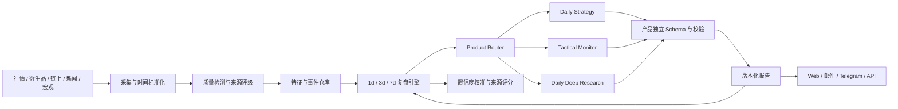

# 生产架构

## 1. 数据流

## 2. 推荐服务边界

- `collector-market`：现货 K 线、订单簿、成交量与跨所价格。
- `collector-derivatives`：资金费率、OI、基差、清算、期权。
- `collector-onchain`：交易所余额、稳定币、网络与协议指标。
- `collector-news`：RSS/API/公告采集、聚类去重、实体和事件抽取。
- `feature-engine`：统一窗口特征、市场状态分类、关键位计算。
- `report-engine`：Daily Strategy、Tactical Monitor、Deep Research 三条独立 pipeline；只共用事实、证据与市场观测。
- `validator`：引用、时效、数值、概率、禁用措辞和一致性校验。
- `publisher`：Web、邮件、Telegram/Discord、Webhook。
- `evaluator`：预测结算、滚动表现、置信度校准。

当前架构使用 Python + FastAPI + Vercel Functions + Vercel Blob。完整报告、任务状态、缓存和导出物按对象路径保存，便于审计并适配无状态函数运行时。

生产环境使用 Vercel Blob，本地开发使用 `./data/` JSON 文件。行情以 OKX 现货、UTC+8 K 线、资金费率和 OI 为主，Bybit 交叉验证 OI，CoinGecko/Coinbase 负责聚合与价格回退。DefiLlama 提供 ETH/SOL 链级 TVL、费用和稳定币供给；BTC 专业链上指标在未授权时显式降级。

## 3. 调度策略

- 数据采集全天运行，频率按数据类型从 5 秒到 15 分钟分层。
- 各任务执行时冻结相应数据快照。每个 feature 标记 INTRADAY / DAILY / SWING / STRUCTURAL。
- 依次执行数据质量、特征计算、报告生成、验证。
- 次日 00:10 发布前一个北京完整自然日 Daily，08:00 / 20:00 发布实时 Tactical；10:00 生成研究资料包，12:00 生成唯一一篇 Pro 洞察，14:00 仅失败时重试完整合同版本。
- reconcile 只在五个关键发布窗口后运行：UTC 00:35、04:35、06:35、12:35、16:35；用于补前一日 Daily、修复 Deep，并只补当前有效 Tactical checkpoint。发布锁负责吸收重叠，同时控制 Vercel Hobby 的 Blob 高级操作消耗。
- 使用 IANA 时区 `Asia/Shanghai`，避免手写 UTC 偏移。
- 深度链路使用日期级幂等键和数据库任务锁；已有合格文章时 14:00 重试直接跳过。

## 4. 数据源原则

生产前需要按授权、覆盖、延迟和成本评估供应商。优先级如下：

1. 交易所官方 WebSocket/REST、项目官方公告、监管机构与宏观数据一手源。
2. 专业聚合商用于跨所校验和历史补齐。
3. 链上、ETF 和期权数据采用有明确口径说明的供应商。
4. 社交媒体只作为线索，不直接成为高置信度事实。

任何供应商都通过适配器接入，核心数据模型不依赖品牌字段。

## 5. 生成安全边界

- 模型只能引用本批次 Evidence Graph 与事实账本中的 ID，不允许自行补数字或新闻。
- 数值、收益率、目标区间由代码计算；模型负责综合解释和表达。
- 缺失值统一保存 `is_available=false,value=null`，不得渲染为零，也不得参与方向权重。
- Tactical/Daily 的质量评分用于修复和降级；深度文章须通过材料与编辑门槛，失败时暂缓本篇且不阻断其他产品。
- 将“市场事实”“研究判断”“预测”以不同字段存储和展示。
- 报告保留提示词版本、模型版本、数据快照和校验结果。

## 6. 最小数据表

- `research_packets`：来源元数据、事实卡、选题、状态和失败原因；不保存新闻全文。
- `market_bars`：标准化 OHLCV。
- `feature_snapshots`：时点特征。
- `evidence_items`：可引用证据。
- `report_runs`：批次、状态和数据质量。
- `reports`：版本化报告正文和 JSON。
- `forecasts`：方向、期限、区间、概率与失效条件。
- `forecast_outcomes`：实际结果和评分。
